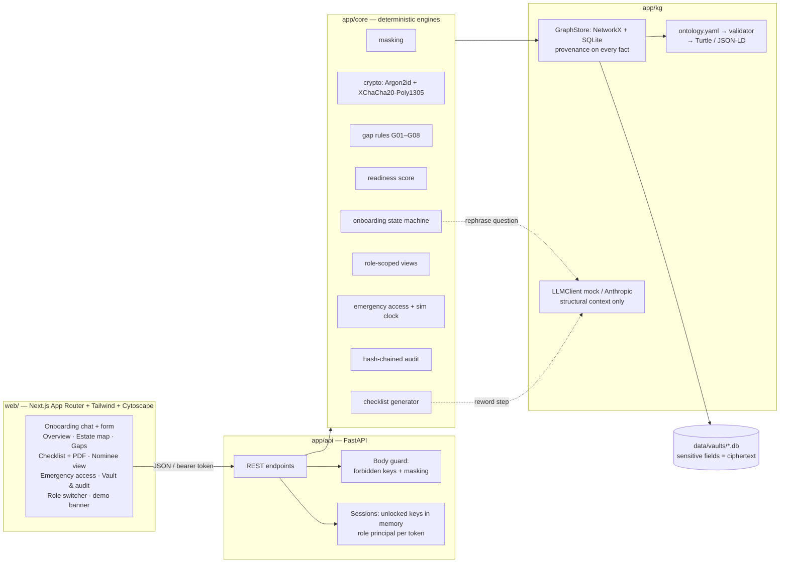

# family-vault (proof of value)

> **DEMO ONLY — synthetic data.** Do not enter real account numbers, ID numbers, passwords or other sensitive data.

When someone in an Indian family dies or falls ill, relatives often don't know which LIC policies, FDs, bank
accounts, demat holdings or property papers exist, who the nominee is, or where the papers are. Assets go
unclaimed. **family-vault** records *where* things are (never full numbers), finds the gaps, and generates an
"if something happens" checklist for the family.

**In 5 minutes a family member sees:** a readiness score (0–100) with the top fixes, an estate map with the gaps
circled, one-click fixes that raise the score, a nominee's read-only view, a step-by-step checklist (printable PDF),
and a simulated emergency-access request that the owner can cancel.

## Quick start

Prerequisites: [uv](https://docs.astral.sh/uv/) (installs Python 3.12 for you) and Node.js 20+.

```bash
make install   # one-time: uv sync + npm install (needs network)
make demo      # seeds 3 synthetic families, builds and starts API :8000 + web :3000
make test      # ruff + pytest (coverage gate 80% on app/core + app/kg) + web tests
make eval      # writes docs/eval-report.md
```

On Windows without GNU make, the bundled `make.cmd` runs the same targets: `make demo` in cmd.exe or `.\make demo`
in PowerShell. Everything runs offline after `make install` (`LLM_MODE=mock` is the default).

Open http://localhost:3000, pick a sample family (the demo passphrase is pre-filled) and follow
[docs/demo-script.md](docs/demo-script.md). API docs: http://localhost:8000/docs.

## Architecture



Repository layout: `app/kg` (ontology, GraphStore, provenance, LLMClient), `app/core` (engines), `app/api`
(FastAPI, sessions, PDF), `web/` (Next.js), `data/seed` (3 synthetic families), `data/eval` (gap manifest and
reference checklists), `docs/`, `tests/`. Plan and assumptions: [PLAN.md](PLAN.md). History: [CHANGELOG.md](CHANGELOG.md).

## What is real vs mocked

| Area | Real in this POV | Mocked / simplified |
|---|---|---|
| Encryption | Argon2id KDF, XChaCha20-Poly1305 field encryption with record/field binding, encrypted export | Key held in server memory while unlocked; no KMS/HSM; one vault passphrase per family |
| Masking guard | Enforced at the API (and mirrored in the UI): last-4 only; rejects full numbers, Aadhaar/PAN-like, card numbers, passwords/PIN/OTP | Pattern-based, not exhaustive |
| Gap rules, readiness, checklists | Deterministic engines, evaluated against a manifest and 9 reference checklists | Checklist content is generic guidance, not institution-verified |
| Roles | Owner, Spouse (full/shared), Nominee, Advisor, Emergency grantee; enforced server-side on every response | **Authentication is simulated**: a role switcher, not per-person logins |
| Emergency access | Full state machine: request → wait → owner notified/cancel → activate → 7-day expiry, all audited | Simulated clock and in-app notifications (no SMS/email); no identity verification or legal review |
| Audit | Append-only, hash-chained, tamper-evident | Stored in the same vault file |
| LLM | `LLMClient` with Anthropic SDK (`LLM_MODE=live`, `ANTHROPIC_MODEL`, default `claude-opus-5-5`) | Default is deterministic mock; LLM only rephrases questions/steps from structural templates |
| Data | Ontology, graph, provenance, RDF export | 3 synthetic families; no real institutions |

## Next steps to productize

1. **Keys and auth:** real KMS/HSM-backed key management; per-member accounts with key wrapping (owner, spouse,
   nominees), device-bound unlock, recovery via Shamir-split recovery kits; real identity proofing (e.g. DigiLocker /
   Aadhaar-based e-KYC done by a regulated partner, never stored by us).
2. **Legal review of emergency access:** waiting periods, proof of death/incapacity, liability, and how it interacts
   with wills, nominations and succession law (nominee ≠ legal heir in many cases).
3. **DPDP Act 2023 compliance:** consent manager flows, purpose limitation, data-principal rights (access, correction,
   erasure), breach notification, Indian data residency, DPO and grievance officer.
4. **India-specific claim guides:** institution-by-institution procedures (LIC, major banks, CDSL/NSDL, CAMS/KFintech,
   EPFO, post office schemes, RTO, sub-registrar), forms, and timelines — reviewed by professionals.
5. **Partnerships:** insurers and banks (nomination update deep links, policy discovery), registrars and depositories
   (consolidated statements), and advisors (CAs, MF distributors, estate lawyers) as a distribution channel.
6. **Pricing hypothesis:** family subscription (₹999–1,999/year per household, free tier with readiness score), plus an
   advisor channel (per-client seats for CAs/distributors who onboard families and fix gaps with them).
7. **Product:** reminders for maturing FDs and policy renewals, annual "family review" ritual, will and POA guidance,
   Indian languages, voice onboarding for older users.

## Security

See [docs/security.md](docs/security.md) for the threat model, key-loss consequences, and what this POV does *not*
protect against. Evaluation results (precision/recall, checklist accuracy, crypto and masking tests):
[docs/eval-report.md](docs/eval-report.md).
